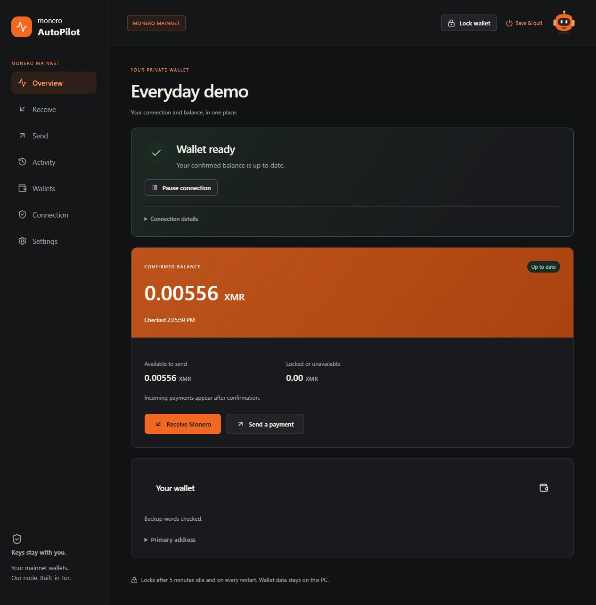
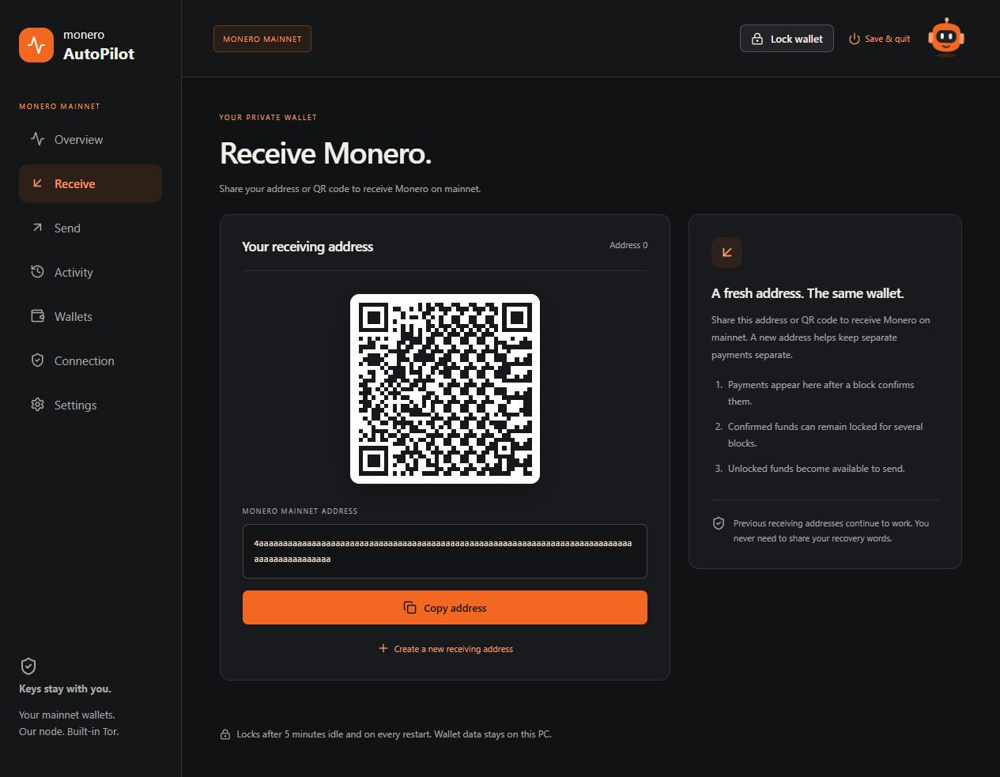
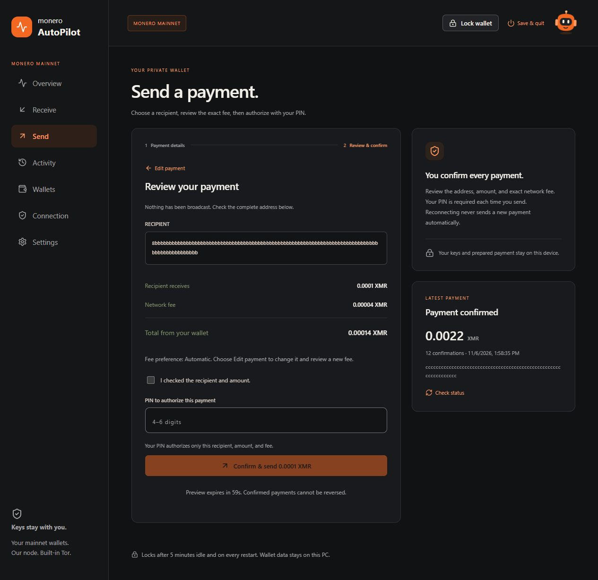
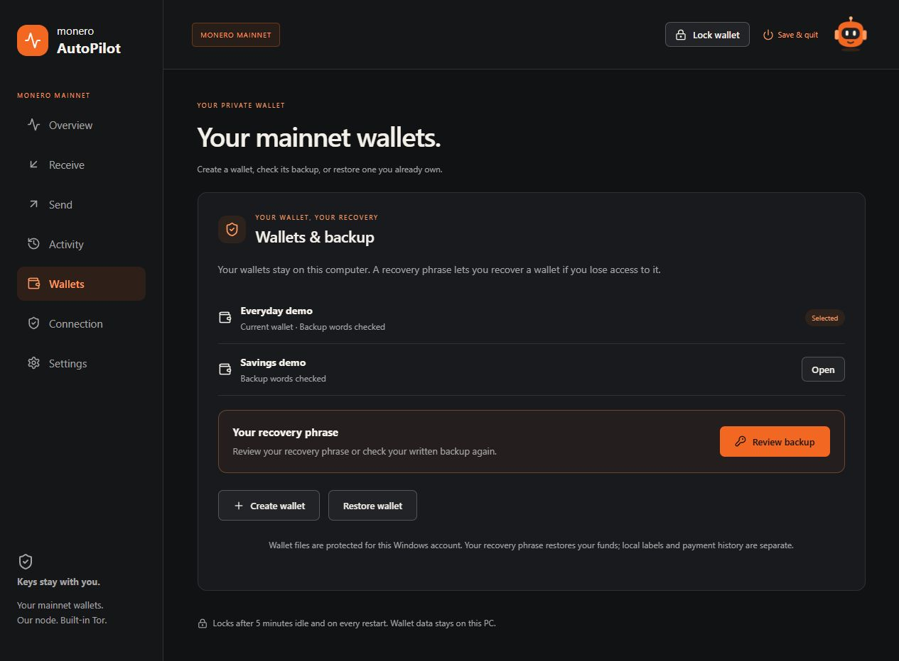
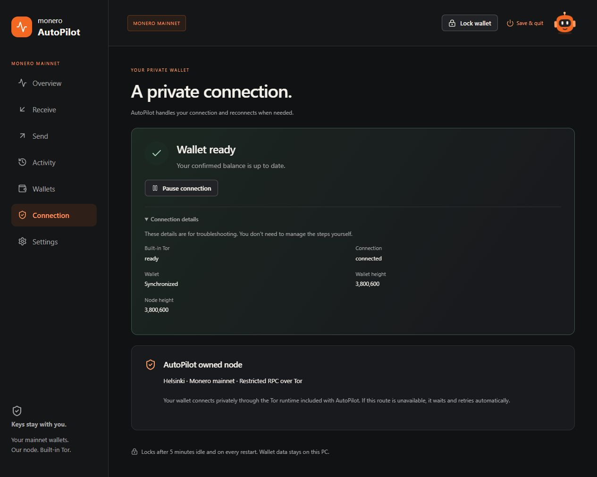
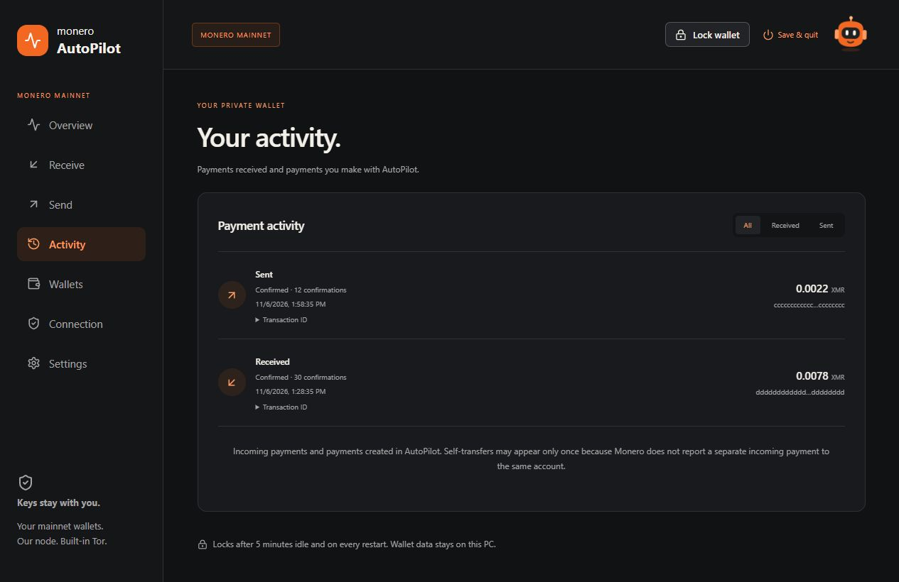
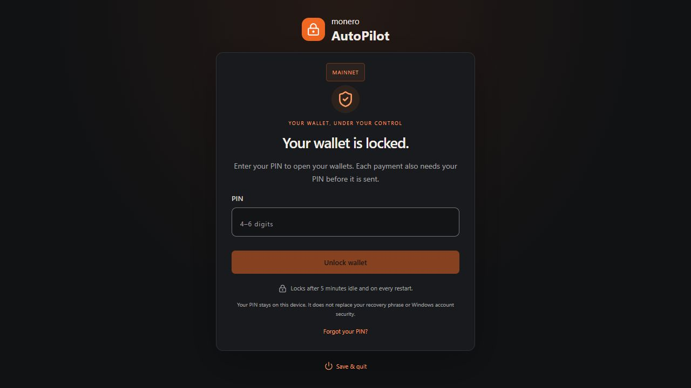
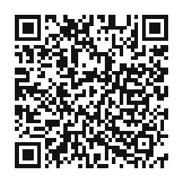

# Monero AutoPilot

**Your keys. Your decisions. Your Monero.**

A Windows desktop wallet that brings Monero payments, local wallet keys, and built-in Tor into one straightforward interface. AutoPilot manages the connection and retries permitted routes; you review and authorize every payment.

[Download for Windows](https://moneroautopilot.com/downloads.html) · [Website](https://moneroautopilot.com) · [Contribute](#contributions-welcome) · [Support the node](#help-keep-the-node-online)

## A look inside

Your confirmed balance, available funds, connection progress, and backup status in one place—with Pip, your wallet companion, in the header.



*Screenshots show the actual app interface with synthetic demo data. The balances, addresses, and transactions pictured are examples; do not send funds to screenshot addresses.*

| Receive Monero | Review and authorize payments |
| --- | --- |
| [](docs/screenshots/receive.jpg) | [](docs/screenshots/send-review.jpg) |
| Share an address or QR code, and create fresh receiving addresses for the same wallet. | Check the recipient, amount, and exact fee before approving with a 4–6 digit PIN. |

| Wallets, backup, and restore | Built-in Tor and reconnection |
| --- | --- |
| [](docs/screenshots/wallets.jpg) | [](docs/screenshots/connection.jpg) |
| Create and switch wallets, check your written backup, or restore with a 25-word English recovery phrase. | Connect to the AutoPilot-operated node over Tor without installing Tor separately. The app waits and retries when the permitted route is unavailable. |

| Payment activity | Wallet locking |
| --- | --- |
| [](docs/screenshots/activity.jpg) | [](docs/screenshots/wallet-lock.jpg) |
| Follow incoming and outgoing payments, confirmations, and fees. An uncertain payment outcome is checked before another send is allowed. | Lock immediately, after five minutes of inactivity, and on every restart. Each payment also requires PIN authorization. |

Click any gallery image for the full-size screenshot. [Screenshot notes](docs/screenshots/README.md).

## Try the app

Get the Windows x64 installer from the [download page](https://moneroautopilot.com/downloads.html), including its SHA-256 checksum and release details.

The current **0.9.0 preview** connects to Monero mainnet. Its installer is unsigned; payments are capped at **0.01 XMR each**, with a maximum network fee of **0.0001 XMR**. Signing and remaining release checks are documented on the download page.

Wallet keys and files stay on your computer. Keep your recovery phrase private and backed up: it controls access to the wallet's funds.

## Contributions welcome

Help make Monero easier to use. Contributions are welcome from developers, designers, writers, and testers.

- **Code:** improve wallet flows, connection recovery, reliability, and packaging.
- **Design and accessibility:** make navigation, forms, errors, and keyboard use clearer.
- **Documentation:** improve setup instructions, recovery guidance, and contributor resources.
- **Testing:** report reproducible bugs and help verify fresh installs, upgrades, and different Windows configurations.
- **Platform support:** help develop and validate macOS and Linux builds; the current downloadable build is Windows x64.

Start with an [issue](https://github.com/DeadKennedyx/monero-autopilot/issues) or open a [pull request](https://github.com/DeadKennedyx/monero-autopilot/pulls). For larger changes, describe the problem and proposed approach in an issue first. Keep pull requests focused, explain the resulting behavior, and include the relevant checks or screenshots.

Read the [app development guide](app/README.md) for prerequisites, builds, and tests, or the [website guide](website/README.md) for local previews. Use synthetic data in examples and tests. Never include recovery phrases, private keys, real PINs, wallet files, credentials, or private logs in an issue or pull request.

## Help keep the node online

AutoPilot runs its own Monero node so the wallet has a maintained connection endpoint. **Your XMR donations help cover server hosting and keep that node running.** Any amount helps; contributions of time and code are welcome too.

**[Donate XMR to support the node →](https://moneroautopilot.com/donate.html)**

Monero mainnet donation address:

```text
48WR4Mfg7QuDhZFF1ZvRwA5sBN532ESqiXq5b2fcJoZjWt6HkJ99ouWFuVFd9nepxvc6hLH1WdhkdNwNggnmvLKtMPKi2e9
```

<a href="https://moneroautopilot.com/donate.html"></a>

Donations are voluntary and do not unlock wallet features. Review the address and amount in your wallet before sending. This is support for Monero AutoPilot, an independent project—not a donation to the Monero Project.

## Repository

- **[app/](app/)** — Tauri desktop application, React interface, Rust wallet runtime, build scripts, and automated tests.
- **[website/](website/)** — landing, download, and donation pages with local assets.
- **[docs/screenshots/](docs/screenshots/)** — app screenshots captured using synthetic demo data.

Standalone component prototypes, wallet files, credentials, runtime downloads, and generated QA reports are excluded. Downloadable installers are distributed separately from the source repository.

## License

[MIT](LICENSE). Bundled upstream components retain their respective licenses. Monero AutoPilot is an independent project and is not an official Monero wallet or an endorsement by the Monero Project.
